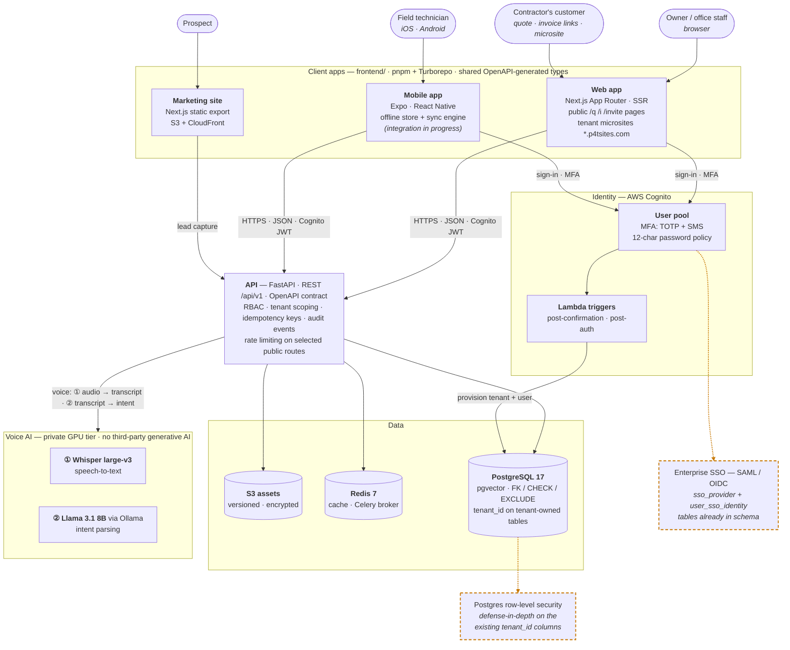
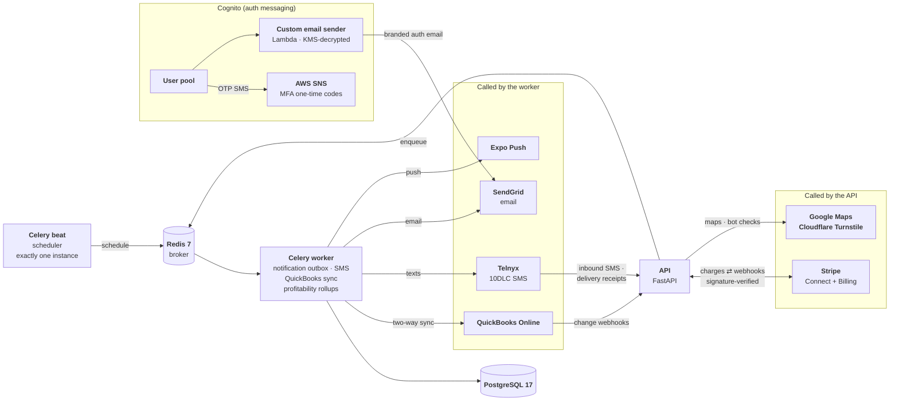

# Container View — what runs, and how it connects

*C4 level 2, in two parts. Every box is a separately deployable unit or a managed service it depends on; every arrow is a call that exists in the code. Solid = built. Dashed orange = enterprise path (designed for, not built). See the [diagram index](README.md) for the legend and sources.*

## 1. The request path — people, apps, identity, data

## 2. Background work and integrations

## What each container is

| Container | Technology | Responsibility | Source |
|---|---|---|---|
| Web app | Next.js (App Router), Tailwind, shadcn/ui, TanStack Query | Office/admin UI; public quote, invoice and invite pages; SSR tenant microsites on `*.p4tsites.com` | `frontend/apps/web/` |
| Mobile app | Expo / React Native, gluestack-ui | Field technician app; on-device store and sync engine built, integration in progress | `frontend/apps/mobile/` |
| Marketing site | Next.js static export | Public site and lead capture (`/api/v1/marketing/waitlist`) | `frontend/apps/marketing/` |
| API | FastAPI (Python 3.14), SQLModel | All business logic behind one versioned REST contract (`backend/openapi.json`); RBAC, tenant scoping, idempotency, audit events, rate limiting on selected public routes (Known Limitations #28) | `backend/api/`, `backend/core/` |
| Celery worker | Celery 5 | Async work: notification outbox, SMS, QuickBooks sync, profitability rollups | `backend/tasks/` |
| Celery beat | Celery 5 | Scheduled jobs; pinned to one instance so jobs never double-fire | `backend/tasks/`, `infrastructure/terraform/modules/compute/main.tf` |
| PostgreSQL 17 | RDS, pgvector | System of record; integrity enforced in the database (foreign keys, CHECK and EXCLUDE constraints) | `dev-docs/db-design/pilot-db-schema-v2.6h.json` |
| Redis 7 | ElastiCache | Celery broker and cache | `infrastructure/terraform/modules/database/main.tf` |
| Voice AI | Whisper large-v3, Llama 3.1 8B (Ollama) on a GPU instance | Speech-to-text and intent parsing with no per-call AI vendor cost ([ADR-0002](../pilot-adr-log.md)) | `backend/services/` |
| Cognito + Lambdas | Cognito user pool; three Python 3.12 Lambdas | Sign-in and MFA; tenant/user provisioning on sign-up; new-device checks; branded auth email | `backend/lambda/`, `infrastructure/terraform/modules/security/main.tf` |

## Enterprise path shown here

- **Enterprise SSO (SAML/OIDC).** The `sso_provider` and `user_sso_identity` tables are already in the schema; wiring them to Cognito federation is the remaining work.
- **Postgres row-level security.** Tenant isolation is enforced in the application/query layer today and covered by a dedicated isolation test suite. Turning on RLS is an additive migration on the existing `tenant_id` columns — defense-in-depth, not a redesign. See [Known Limitations](../../diligence/Pilot-Known-Limitations.md).
