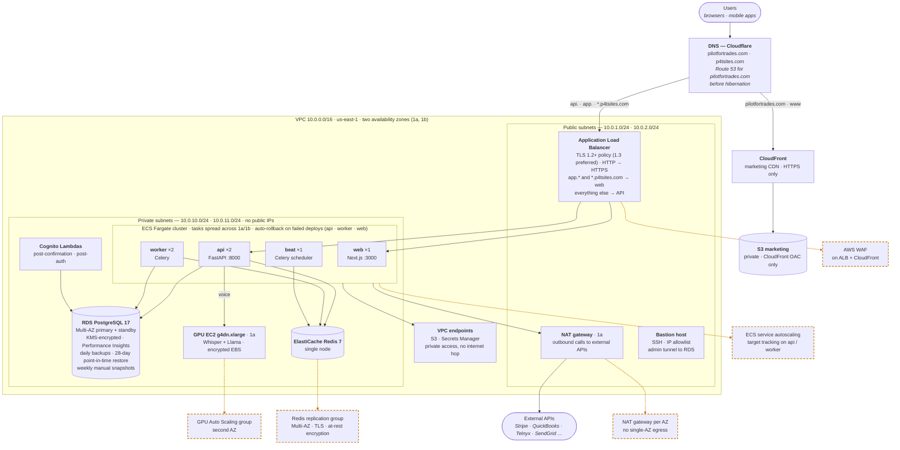
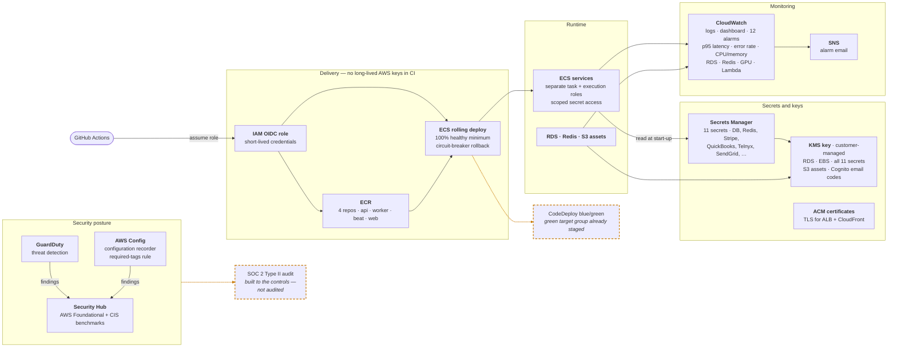

# AWS Deployment View — where it runs

*Dashed arrows run from today's component to its enterprise upgrade. The production topology as built and defined in Terraform (`infrastructure/terraform/environments/production/`, which composes the six modules in `infrastructure/terraform/modules/`). Solid = built. Dashed orange = enterprise path (designed for, not built). See the [diagram index](README.md) for the legend and sources.*

> **State today:** this is the as-built topology from July–September 2026. At hibernation the stack was deliberately torn down to a near-zero cost floor ([ADR-0020](../pilot-adr-log.md), [ADR-0021](../pilot-adr-log.md)); only the marketing site's S3 bucket and CloudFront distribution remain. Restart is `terraform apply` plus data provisioning ([ADR-0016](../pilot-adr-log.md)), documented in the [ops runbook](../../devops/aws-ops-runbook.md).

## 1. Network and runtime topology

## 2. Security, operations, and delivery

## Why it's built this way

- **Cost cap as a design constraint.** The platform was designed to run for about $888/month at 100 customers under a $1,000 design cap. That drives the small instance classes, the single NAT gateway and the single Redis node — each a deliberate, documented trade-off, not an oversight. See [ADR-0001](../pilot-adr-log.md) (Fargate-first), [ADR-0002](../pilot-adr-log.md) (owned GPU) and [ADR-0003](../pilot-adr-log.md) (single Multi-AZ RDS).
- **Only the load balancer, CloudFront and an IP-allowlisted SSH bastion are reachable from the internet.** The services, database, cache and GPU sit in private subnets with no public IPs; the marketing bucket is reachable only through CloudFront.
- **Data that matters is protected by default.** The database is Multi-AZ, with daily automated backups (any point in the last 28 days can be restored) plus weekly manual snapshots kept indefinitely; one customer-managed KMS key encrypts the database, disks, secrets and asset storage; secrets live in Secrets Manager and are read at start-up rather than baked into images.
- **Deploys are designed not to take the site down.** Rolling ECS deploys keep 100% of healthy tasks until the new ones pass health checks, and roll back automatically if they don't.

## Enterprise path

| Upgrade | Why it's next | Starting point already in place |
|---|---|---|
| AWS WAF on the ALB and CloudFront | Managed protection against common web attacks and bots | TLS 1.2+ policy (TLS 1.3 preferred) on the ALB; Cloudflare Turnstile on public forms |
| NAT gateway per AZ | Removes the one remaining single-AZ dependency for outbound calls | Subnets and route tables already split across two AZs |
| ECS service autoscaling | Scale api/worker on load instead of fixed counts | Services already stateless, spread across AZs, behind the ALB |
| Redis replication group (Multi-AZ, TLS, at-rest encryption) | High availability and encryption for the broker/cache | Called out in the Terraform as the "Phase 2 upgrade path" |
| GPU Auto Scaling group / second AZ | Removes the single voice-AI instance as a capacity ceiling and failure point | [ADR-0002](../pilot-adr-log.md) records the scaling trigger (≈500 tenants or p95 > 2.5 s) |
| RDS read replica / RDS Proxy | Offload reporting reads; pool connections at higher task counts | Multi-AZ instance, Performance Insights and connection alarms already on |
| CodeDeploy blue/green for the API | Instant cut-over and rollback between two task sets | Second ("green") API target group already provisioned |
| SSM Session Manager in place of the bastion | Audited admin access with no open SSH port | GPU instance already has the SSM policy attached |
| AWS Backup plan with cross-region copies / DR | Automates the weekly snapshot and survives a full-region outage | Daily automated backups with 28-day point-in-time restore, weekly manual snapshots, and the restart runbook |
| SOC 2 Type II audit | Independent attestation | Security Hub (Foundational + CIS), Config, GuardDuty, KMS, audit-event logging — technical design follows the SOC 2 security criteria; built to the controls, not audited |

## Sources

`infrastructure/terraform/modules/{networking,compute,database,security,storage,monitoring}/main.tf` · `infrastructure/terraform/environments/production/main.tf` · `.github/workflows/deploy-production.yml` · [ADR log](../pilot-adr-log.md) · [AWS infrastructure as-built](../../devops/aws-infrastructure-as-built.md)
