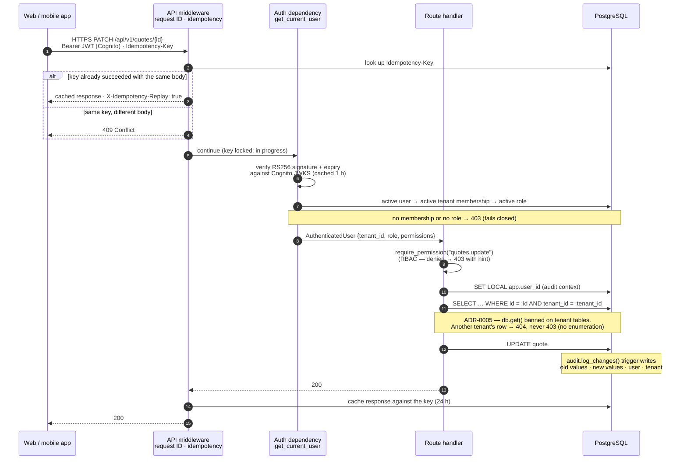
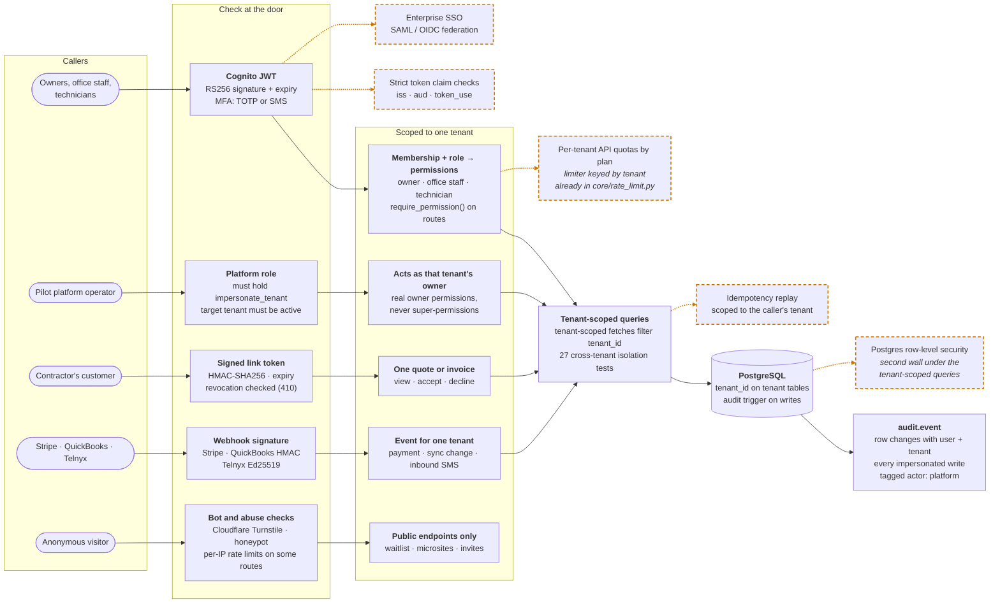

# Security and Tenant Isolation — how a request is trusted

*How the API decides who is calling, which tenant they belong to, and what they may touch. Drawn from `backend/core/` and `backend/api/routes/`. Solid = built. Dashed orange = enterprise path (designed for, not built). See the [diagram index](README.md) for the legend and sources.*

## 1. One authenticated write, end to end

A technician updating a quote from the mobile app. Every step below is code that runs on every authenticated write.

## 2. Every way in, and what guards it

The API has five kinds of caller. Each gets its own check before it reaches tenant data.

## What this shows

- **Isolation is enforced in the query, not after it.** [ADR-0005](../pilot-adr-log.md) bans `db.get()` on any tenant-owned table. Every tenant-scoped fetch filters on `tenant_id` in SQL (a few route groups miss the caller check — Known Limitations #27), and a miss returns 404 so one tenant can't learn that another's record exists. A dedicated suite (`backend/tests/test_multi_tenancy_isolation.py`, 27 tests) tries cross-tenant reads and writes across customers, sites, jobs, quotes, catalog and voice sessions.
- **Fails closed.** A valid token is not enough. The caller must have an active user record, an active tenant membership and an active role, or the request stops with 403.
- **Every write is attributable.** The route sets `app.user_id` for the transaction, and a database trigger (`audit.log_changes()`) records old and new values, the user and the tenant. Operator impersonation gets its own audit event on every mutating request.
- **Retries are safe.** The mobile app is designed to queue work offline for up to 72 hours (the sync layer was ~70% integrated at hibernation), so duplicate submissions on reconnect are expected. Writes carry an `Idempotency-Key`, and a replay returns the original response instead of creating a second record ([ADR-0006](../pilot-adr-log.md)).
- **No unsigned callers.** Customer-facing links are HMAC-signed with an expiry and can be revoked. Webhooks are rejected without a valid provider signature.

## Enterprise path shown here

| Upgrade | Why it's next | Starting point already in place |
|---|---|---|
| Postgres row-level security | A second, database-enforced wall under the application's tenant filter | `tenant_id` already on tenant tables; queries already filter on it; isolation test suite to prove it |
| Enterprise SSO (SAML / OIDC) | Customers sign in with their own identity provider | `sso_provider` and `user_sso_identity` tables in the schema; Cognito supports federation |
| Strict token claim checks (`iss`, `aud`, `token_use`) | Accept only tokens issued to Pilot's own app clients | Signature, expiry and key rotation (JWKS cache with TTL) already verified |
| Per-tenant API quotas by plan | Fair use across tenants; plan-based limits | Limiter keyed by tenant with per-tier limits defined (`core/rate_limit.py`); applied today to public, abuse-prone endpoints |
| Tenant-scoped idempotency replay | Bind a cached replay to the tenant that created it | Keys already store `tenant_id` and `user_id` |

## Sources

`backend/core/auth.py` · `backend/core/permissions.py` · `backend/core/idempotency.py` · `backend/core/rate_limit.py` · `backend/core/db.py` · `backend/app/main.py` · `backend/services/public_link_signer.py` · `backend/api/routes/webhooks.py`, `webhooks_stripe.py`, `webhooks_sms.py`, `marketing.py` · `backend/migrations/versions/` (audit trigger) · `backend/tests/test_multi_tenancy_isolation.py` · [ADR log](../pilot-adr-log.md) · [Known Limitations](../../diligence/Pilot-Known-Limitations.md)
