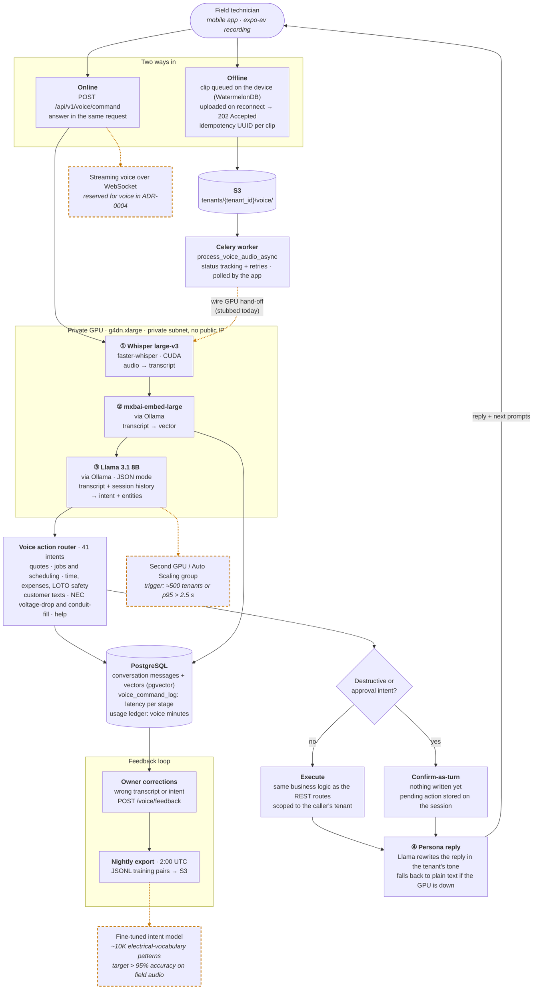
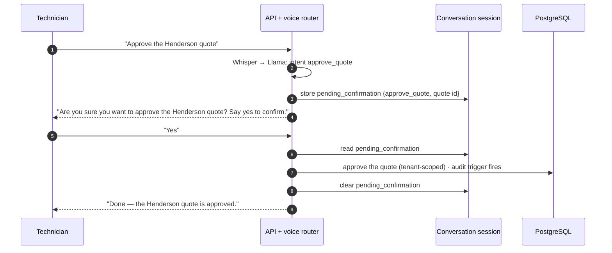

# Voice AI Pipeline — from a technician's voice to a saved record

*How a spoken command becomes an action in Pilot, on Pilot's own GPU. Drawn from `backend/api/routes/voice.py`, `backend/services/ai_service.py`, `backend/services/voice_action_router.py`, `backend/tasks/voice_offline_tasks.py` and the mobile offline queue. Solid = built. Dashed orange = enterprise path (designed for, not built). See the [diagram index](README.md) for the legend and sources.*

> **Where it stands:** the online pipeline is built end to end, and the GPU instance was provisioned and ran in the AWS environment (built to production spec, no customer traffic) before hibernation. For offline clips, capture, upload, storage and status tracking are built, but the background worker's hand-off to the GPU is still a stub. The intent model is stock Llama 3.1 8B with prompt engineering. Fine-tuning and field validation against real contractor audio are the deliberate final step ([Known Limitations](../../diligence/Pilot-Known-Limitations.md) #16).

## 1. The pipeline

## 2. Confirm-as-turn — how voice avoids irreversible mistakes

Speech recognition will sometimes mishear, so intents that approve, send back, reschedule over a conflict or delete never run on the first utterance. The router stores the pending action on the conversation session and asks. Only an explicit "yes" on the next turn commits it. For offline clips, the design holds these intents the same way, notifies the technician and expires unconfirmed actions after 24 hours; that path arrives with the GPU hand-off.

## Why it's built this way

- **Fixed cost, private data.** All speech and language models run on one dedicated GPU instance instead of per-call AI APIs, so voice usage can't blow through the cost cap, and contractors' audio and job data never go to a third-party model ([ADR-0002](../pilot-adr-log.md)). The one external AI call in the product is OpenAI embeddings for the in-app help articles, which index Pilot's own documentation.
- **Voice is a front door, not a second backend.** The router calls the same implementations the REST API uses, with the same tenant-scoped user context, so a voice-created quote follows the same rules as one typed in the web app.
- **Built for job sites with no signal.** Clips captured offline are queued on the device and uploaded with an idempotency key on reconnect, so a retry never creates a duplicate. Background processing tracks each clip's status for the app to poll.
- **Measured from day one.** Every command logs per-stage latency (Whisper, Llama, action, total) and its outcome, and records voice minutes in the usage ledger for metered billing.

## Enterprise path shown here

| Upgrade | Why it's next | Starting point already in place |
|---|---|---|
| Offline clip processing on the GPU | Commands recorded with no signal get acted on, not just stored | Queue, upload, S3 storage, idempotency and status polling built; the worker task and confirm/expire hooks are in place as stubs |
| Fine-tuned intent model | Electrical vocabulary and accent robustness beyond prompt engineering | Owner-correction feedback captured; nightly JSONL training export to S3 |
| Field validation to > 95% accuracy | Proof on real job-site audio before scale | Per-command outcome and latency logging in `voice_command_log` |
| Streaming voice over WebSocket | Lower perceived latency; interim transcripts | Transport decision recorded in [ADR-0004](../pilot-adr-log.md) |
| Second GPU / Auto Scaling group | Capacity and failover for the voice tier | Scaling trigger recorded in [ADR-0002](../pilot-adr-log.md); GPU URLs already resolved from Secrets Manager, not hard-coded |

## Sources

`backend/api/routes/voice.py` · `backend/api/routes/voice_feedback.py` · `backend/services/ai_service.py` · `backend/services/voice_action_router.py` · `backend/services/voice_persona_renderer.py` · `backend/tasks/voice_offline_tasks.py` · `backend/tasks/voice_feedback_export.py` · `backend/core/config.py` · `frontend/apps/mobile/database/sync/voice-upload.ts` · `infrastructure/terraform/modules/compute/gpu_userdata.sh` · [ADR log](../pilot-adr-log.md) · [Known Limitations](../../diligence/Pilot-Known-Limitations.md)
