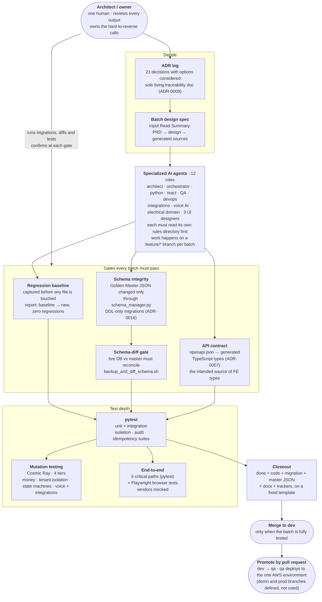
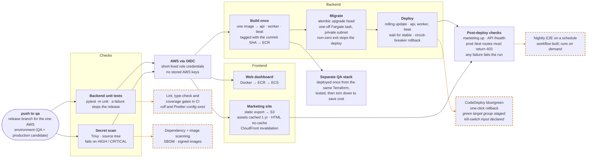

# Delivery and Governance — how a change gets from idea to a deployed AWS environment

*How work is designed, built, checked and shipped: one human architect directing specialized AI agents, behind a set of hard gates. Drawn from `METHOD.md`, `.roomodes`, the ADR log, `backend/schema_manager.py`, `admin-tools/` and `.github/workflows/`. Solid = built. Dashed orange = enterprise path (designed for, not built). See the [diagram index](README.md) for the legend and sources.*

## 1. Making a change — the gated workflow

## 2. Shipping it — the deploy pipeline

## What this shows

- **Decisions are written down before they're built.** Every architecture decision is in the [ADR log](../pilot-adr-log.md) with the options that were rejected and why. Designs cite their inputs, so a reviewer can trace a feature back to the requirement.
- **The agents have no latitude on the dangerous parts.** The schema changes only through one tool, migrations carry structure only (all data comes from environment-aware seed scripts), the frontend has generated types from the API contract as its intended source (some hand-written interfaces remain; Known Limitations #8), and no batch closes without a before-and-after test count. The human runs the migrations, schema diffs and test suites at each gate.
- **Tests aim at what would hurt most.** Mutation testing is tiered by blast radius: financial correctness first, then tenant isolation, then workflow state machines, then voice and integrations.
- **AWS access from CI is keyless.** CI assumes an AWS role through GitHub OIDC; there are no long-lived AWS keys in the repo or the CI settings.
- **Manual deploys where they paid off.** For most of the build, deploys were run by hand so that interim builds, single components or one integration at a time could be tested in AWS. The pipeline handles full releases from the `qa` branch.
- **One artifact, three services.** The API, worker and scheduler run the same image built once per commit, so they can't drift apart, and the migration runs inside the VPC before any new code takes traffic.

## Enterprise path shown here

| Upgrade | Why it's next | Starting point already in place |
|---|---|---|
| Lint, type-check and coverage gates in CI | Style, typing and coverage regressions stop the release, not just failing tests | Unit tests and post-deploy checks already block; ruff and Prettier configured; coverage measured (76% backend) |
| Dependency and image scanning, SBOM, signed images | Supply-chain assurance | Trivy already in the pipeline for secrets |
| Standing separate QA environment | Prove a release in a production-like environment before it would reach customers | QA infrastructure already deployed and tested once from the same Terraform, then torn down to save cost; environment profiles for dev, e2e, QA and prod ([ADR-0016](../pilot-adr-log.md)) |
| CodeDeploy blue/green with one-click rollback | Instant cut-over and rollback | Green target group provisioned; kill-switch input declared in the workflow |
| Scheduled nightly E2E | Catch regressions in the critical paths every day | Two-tier E2E workflow built; runs on demand |

## Sources

`METHOD.md` · `.roomodes` · [ADR log](../pilot-adr-log.md) (ADR-0007, -0009, -0016) · `backend/schema_manager.py` · `backend/README-cosmic-ray.md` · `admin-tools/backup_and_diff_schema.sh` · `.github/workflows/deploy-production.yml` · `.github/workflows/e2e-nightly.yml` · `frontend/.husky/pre-commit`
