# Enterprise Maturity Map — built today, and the next step

*The one-page summary of diagrams 1–5. Each row is one dimension an enterprise buyer or acquirer would diligence: what is built today, and the upgrade it is already positioned for. Solid = built. Dashed orange = enterprise path (designed for, not built). See the [diagram index](README.md) for the legend and sources.*

```mermaid
flowchart TB
  subgraph r1["Tenancy and isolation"]
    direction LR
    b1["Tenant-scoped queries (exceptions: KL #27) · 404 on miss<br/>db.get() banned (ADR-0005) · 27 isolation tests<br/>mutation-tested as tier 2"]
    n1["Postgres row-level security<br/>as a second wall"]:::path
    b1 -.-> n1
  end

  subgraph r2["Identity and access"]
    direction LR
    b2["Cognito · TOTP + SMS MFA · 12-char policy<br/>role-based permissions · fails closed<br/>audited operator impersonation"]
    n2["Enterprise SSO (SAML / OIDC)<br/>strict token claim checks (iss / aud / token_use)"]:::path
    b2 -.-> n2
  end

  subgraph r3["Data protection"]
    direction LR
    b3["Customer-managed KMS key · RDS, EBS, S3, secrets<br/>11 secrets in Secrets Manager · OAuth tokens encrypted<br/>row-change audit trigger · daily backups (28-day restore)<br/>weekly manual snapshots"]
    n3["AWS Backup plan with cross-region copies<br/>Redis encryption in transit + at rest,<br/>plus an auth token"]:::path
    b3 -.-> n3
  end

  subgraph r4["Availability and scale"]
    direction LR
    b4["Multi-AZ RDS · ECS spread over 2 AZs<br/>auto-rollback deploys · idempotent writes<br/>offline mobile capture (sync ~70%)"]
    n4["Autoscaling · Redis replication group<br/>NAT per AZ · second GPU · read replica"]:::path
    b4 -.-> n4
  end

  subgraph r5["Network and edge"]
    direction LR
    b5["Private subnets, no public IPs (except an IP-allowlisted bastion) · TLS 1.2+ ALB<br/>VPC endpoints · signed webhooks and links (fallbacks: KL #28)<br/>Turnstile + rate limits on some public routes"]
    n5["AWS WAF on ALB + CloudFront<br/>SSM in place of the bastion<br/>per-tenant API quotas by plan"]:::path
    b5 -.-> n5
  end

  subgraph r6["Security operations and compliance"]
    direction LR
    b6["GuardDuty · Security Hub (Foundational + CIS)<br/>AWS Config · required-tags rule<br/>Trivy secret scan in CI"]
    n6["SOC 2 Type II audit<br/>dependency + image scanning · SBOM"]:::path
    b6 -.-> n6
  end

  subgraph r9["Observability"]
    direction LR
    b9["CloudWatch logs for every service · dashboard<br/>12 alarms → SNS email · RDS Performance Insights<br/>X-Request-ID on every request · voice latency per stage"]
    n9["OpenTelemetry traces + metrics<br/>Sentry error monitoring"]:::path
    b9 -.-> n9
  end

  subgraph r7["Delivery"]
    direction LR
    b7["OIDC to AWS, no stored keys · tests and smoke checks block<br/>build once per commit · in-VPC migrations first<br/>21 ADRs · schema-diff and contract gates"]
    n7["Lint, type-check, coverage gates<br/>standing QA environment · CodeDeploy blue/green"]:::path
    b7 -.-> n7
  end

  subgraph r8["Voice AI"]
    direction LR
    b8["Dedicated GPU instance · Whisper + Llama, no third-party generative AI<br/>41 intents · confirm-as-turn on destructive actions<br/>per-stage latency logging · correction export"]
    n8["Fine-tuned intent model · field validation<br/>offline clips on the GPU · streaming voice"]:::path
    b8 -.-> n8
  end

  r1 ~~~ r2 ~~~ r3 ~~~ r4 ~~~ r5 ~~~ r6 ~~~ r9 ~~~ r7 ~~~ r8

  classDef path stroke:#c77700,stroke-width:2px,stroke-dasharray:6 4;
  linkStyle 0,1,2,3,4,5,6,7,8 stroke:#c77700,stroke-width:2px;
```

## Reading the map

- **The left column is real.** Everything in a solid box is in the code, the Terraform or the CI workflows, and is shown in more detail in the diagram it came from.
- **The right column is an upgrade, not a rewrite.** Each dashed box sits on top of something already built: RLS on the existing `tenant_id` columns, SSO on tables already in the schema, blue/green on a target group already provisioned, fine-tuning on a correction corpus already being exported.
- **The gap is deliberate.** Most of the right column is spend or scale that a pre-revenue product shouldn't carry yet. The platform was designed to run under a $1,000/month cap at 100 customers ([ADR-0001](../pilot-adr-log.md)–[ADR-0003](../pilot-adr-log.md)), and the upgrades are triggered by customer count, contract requirements or measured load.
- **What isn't claimed.** No SOC 2 audit has been done; the technical design follows the SOC 2 security criteria, with no organizational controls. Tenant isolation is enforced in the application today, not by the database. The voice model has not been fine-tuned or field-validated. See [Known Limitations](../../diligence/Pilot-Known-Limitations.md) for the full list.

## Where each row is detailed

| Row | Diagram |
|---|---|
| Tenancy and isolation · Identity and access | [3 — Security and tenant isolation](03-security-tenant-isolation.md) |
| Data protection · Availability and scale · Network and edge · Security operations · Observability | [2 — AWS deployment view](02-aws-deployment-view.md) |
| Delivery | [5 — Delivery and governance](05-delivery-and-governance.md) |
| Voice AI | [4 — Voice AI pipeline](04-voice-ai-pipeline.md) |
| How it all fits together | [1 — Container view](01-container-view.md) |
